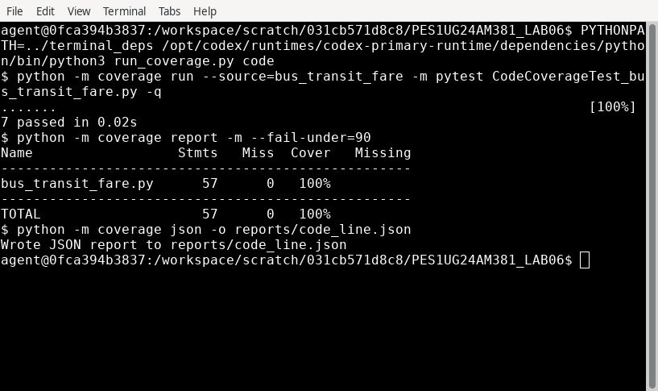

# Lab 6: Code Coverage

Nishanth Nag M V | PES1UG24AM381

The code coverage suite passes 7 tests and executes all 57 application statements (100%). The original application and starter test are unchanged.

```sh
python -m pip install -r requirements.txt
python run_coverage.py code
```



Baseline and improved text/JSON reports are in reports/. Branch coverage is the next submission stage.
